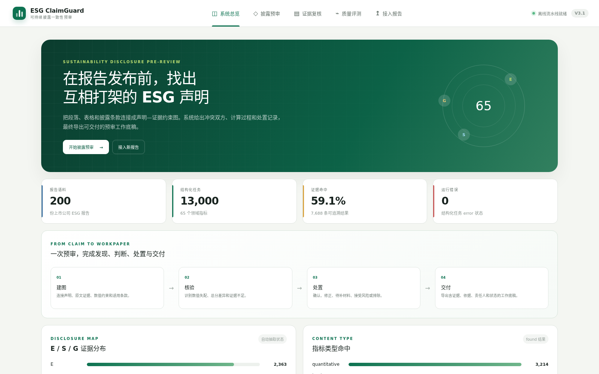
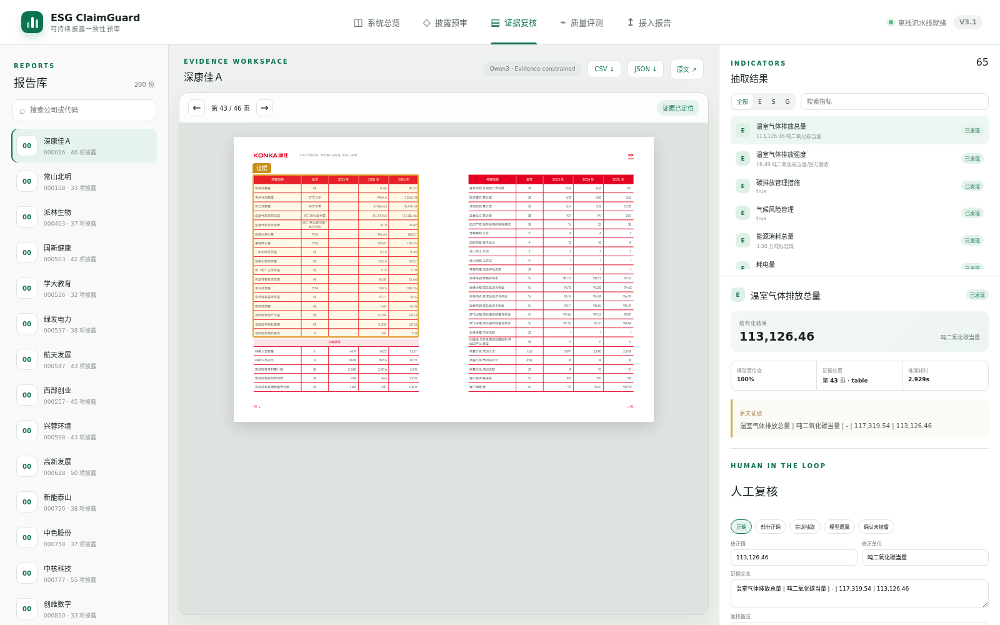
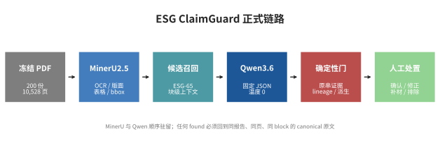
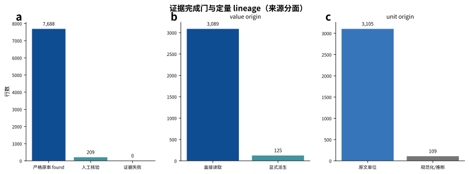
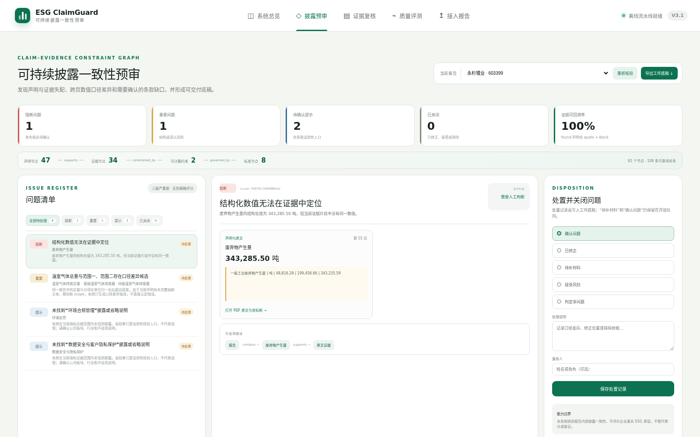
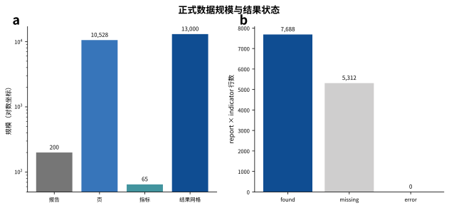

在第八届中国研究生人工智能创新大赛中，我做了 ESG ClaimGuard，一个面向 ESG 报告编制和内部复核的披露一致性预审系统。它把长篇 PDF 整理成**按指标组织的任务**，复核人员可以从一条结果直接看到原文页、逐字引文、数值和单位，再记录处理意见、导出底稿。

正式运行处理了 **200 份报告、10,528 页内容**，覆盖 65 个指标，共 **13,000 个“报告×指标”任务**。项目中，我把公开报告获取、版面解析、模型抽取和网页复核接成了一条可以追查的流程。

代码、冻结结果和参赛材料保存在 [ESG ClaimGuard 仓库](https://github.com/yangzhe0/duibuqi-duibuqi-esg-claimguard)。



## 从一条温室气体排放指标开始

在报告库选择深康佳 A，打开“温室气体排放总量”，工作台会定位到 PDF 第 43 页的表格区块。右侧显示抽取值 `113,126.46` 和单位“吨二氧化碳当量”，下方同时保留原文引文。

这条记录需要把几种信息接在一起：报告来自哪个公告，当前 PDF 是哪一份文件，数值出现在什么页、什么区块，以及模型选择了表格中的哪一列。表格中还有另一个年度的 `117,319.54`，复核人员要能看到两列的上下文，才能判断抽取结果对应的期间。



两张页面截图来自参赛材料归档。证据页沿用当时的界面字段，其中“模型置信度”是界面展示值；本项目的结果评价使用后文的证据校验统计。

这个场景决定了系统的数据结构。抽取结果除了 `value` 和 `unit`，还需要保存 `report_id`、`page_no`、`block_id`、`quote`，并继续记录数值和单位的来源。页面里的“回到原文”有了稳定的连接字段，后续校验也有了具体对象。

## 从公开报告到结构化证据

### 先固定报告，再解析版面

数据从巨潮资讯的公开公告和 PDF 开始。下载日志记录成功、跳过和失败；报告索引保存公告来源、附件地址、本地路径、文件大小和 SHA-256。正式运行再用 manifest 固定输入队列。

这里把“已下载”与“正式使用”分开记录：原始目录保留 210 份报告，正式队列选用 manifest 中的 200 份。这样，统计任务规模和复验结果时都有明确的输入集合，后续新增文件也不会悄悄改变本轮实验。

MinerU 将 PDF 解析成带页码和版面信息的区块，保留文本、表格、坐标和区块类型。表格中的单位常在表头，年度常在列名，附注又可能位于另一块内容中；保留这些结构，才能在抽取和复核时查看上下文。

处理链路如下：

```text
公告来源与 PDF
  → 下载日志、报告索引、文件哈希
  → MinerU 页级与区块级解析
  → ESG-65 指标候选召回
  → Qwen3.6-27B 结构化抽取
  → 证据校验与异常处置
  → 预审、人工复核和底稿导出
```



*正式材料中的处理链路：文档解析、候选召回、语义抽取、证据校验和人工处置分别承担一段工作。*

### 让模型围绕一个指标读取候选区块

ESG-65 指标池包括环境 25 项、社会 20 项、治理 20 项。每份报告都跑同一套指标，任务可以用 `(report_id, indicator_id)` 唯一标识。

召回先按指标名称、别名和相关表达缩小候选范围，再把一个指标及其候选区块交给模型。这样，模型输入和输出都围绕一项任务组织，错误发生时也能直接回查该指标看到过哪些内容。

Qwen 返回固定 JSON，包含状态、页码、区块、引文、数值、单位和说明。程序接着核验这些字段：区块是否存在，页码是否一致，引文能否在指定原文中找到，以及定量字段是否保留来源。

> **提示词规定格式，代码检查结果**；字段错误、证据无法匹配等情况进入重试、修正或状态降级，整个过程另留诊断记录。

### 把数值来源也做成可检查的字段

报告中的定量结果有不同形成方式。有些数值直接出现在表格中，有些需要计算；单位也可能写在当前单元格、表头或相邻说明里。因此，结果另存 `value_origin`、`unit_origin` 等字段，把原样读取、计算和单位处理区分开。

对复核人员而言，这决定了检查路径。直接值可以先核对单元格和年度；派生值则要继续看计算关系及参与计算的原文。把这些区别保存在数据层，页面和导出底稿就能沿用同一套信息。

正式结果中的 3,214 条定量 `found` **都保存了数值与单位来源**，其中直接值 3,089 条、派生值 125 条。这些字段也为后续数值一致性检查提供了输入。



*三个面板分别查看证据完成门、数值来源与单位来源，统计口径对应冻结的验证结果。*

## 抽取结果怎样变成预审问题

业务层将声明组织为主体、指标、期间、数值、单位、范围和证据的组合。在当前结构化程度下，系统重点生成几类可操作的复核任务：数值无法在证据中定位，总量与分项经单位归一后不一致，以及当前候选范围没有找到合格披露证据。

例如，项目文档保留了一条“废弃物产生量”的反例：结构化值为 `343,285.50` 吨，当前引文中却没有原样出现这个结果。预审页把它列为“结构化数值无法在证据中定位”，让复核人员查看分项、计算依据和原页，再决定修正还是补充证据。



*预审页将问题列表、当前声明与处置表单放在一起，便于围绕一条异常记录继续核对。*

工作台同时保留**原始抽取和人工处置**。原始结果说明模型当时给了什么，处置记录说明复核人员怎样处理，二者一起进入可追查的底稿。

## 13,000 个任务怎样验收

完整任务集合为：

$$
\mathcal T=\mathcal R\times\mathcal I,\qquad
|\mathcal T|=200\times65=13{,}000.
$$

校验程序据此检查报告数、指标集合、任务唯一键和状态，再逐条检查证据及定量字段。冻结的 `validation.json` 保存了本轮结果：

| 检查项 | 结果 |
| --- | --- |
| 正式报告 | 200 份 |
| 唯一报告与指标任务 | 13,000 条 |
| `found` / `missing` / `error` | 7,688 / 5,312 / 0 |
| `found` 可追溯至解析区块并通过逐字引文检查 | 7,688 条 |
| 定量 `found` 的数值和单位来源完整 | 3,214 条 |



*左图汇总正式数据规模，右图展示 7,688 条 found、5,312 条 missing 和 0 条 error。*

这里的 `found` 表示候选通过了内部证据约束，`missing` 表示在本轮解析与召回范围内没有找到合格候选。上述统计验收的是**任务覆盖和证据可追溯性**；语义准确率需要另建独立人工标注集评价。

运行中还留下了 209 条证据字段不满足约束的异常处置记录：193 条在现有候选区块中重新截取证据，16 条改为 `missing`。把异常留在产物里，能帮助下一轮判断问题发生在解析、召回、抽取还是校验阶段。

## 这次工程中最值得继续做的部分

页面需要的交互，反过来推动了后端的数据设计。要高亮原页，就得保存页码和区块；要修改结果，就得保留原始记录与处置记录；要复验一次正式运行，就得固定 manifest 和文件哈希。这些要求最终汇集到同一条数据链路上。

目前更复杂的跨声明比较仍受主体、期间和范围字段完整度影响。下一步可以先补齐这些字段的标注与评测，再扩展规则。同时，应按 OCR、召回和抽取分别统计错误，让新增解析器或模型时能够比较同一批任务的变化。

这个项目已经保留了报告输入、冻结结果、验证脚本和工作台。复看时，可以从证据页的一条结果出发，再回到对应区块和校验记录，检查整条链路是否仍然连得上。

## 代码与复看入口

- [项目仓库](https://github.com/yangzhe0/duibuqi-duibuqi-esg-claimguard)
- [参赛项目文档](https://github.com/yangzhe0/duibuqi-duibuqi-esg-claimguard/tree/main/docs/contest_materials/submission)
- [抽取核心实现](https://github.com/yangzhe0/duibuqi-duibuqi-esg-claimguard/tree/main/src/esg_demo)
- [正式运行结果与验证文件](https://github.com/yangzhe0/duibuqi-duibuqi-esg-claimguard/tree/main/outputs/final_results)
- [后端 API](https://github.com/yangzhe0/duibuqi-duibuqi-esg-claimguard/tree/main/dashboard_api) 与 [前端工作台](https://github.com/yangzhe0/duibuqi-duibuqi-esg-claimguard/tree/main/dashboard_web)
