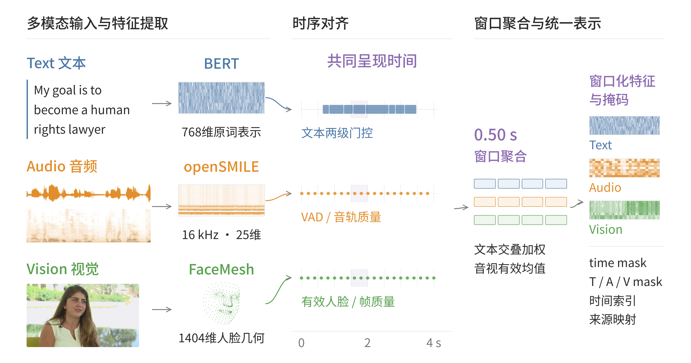
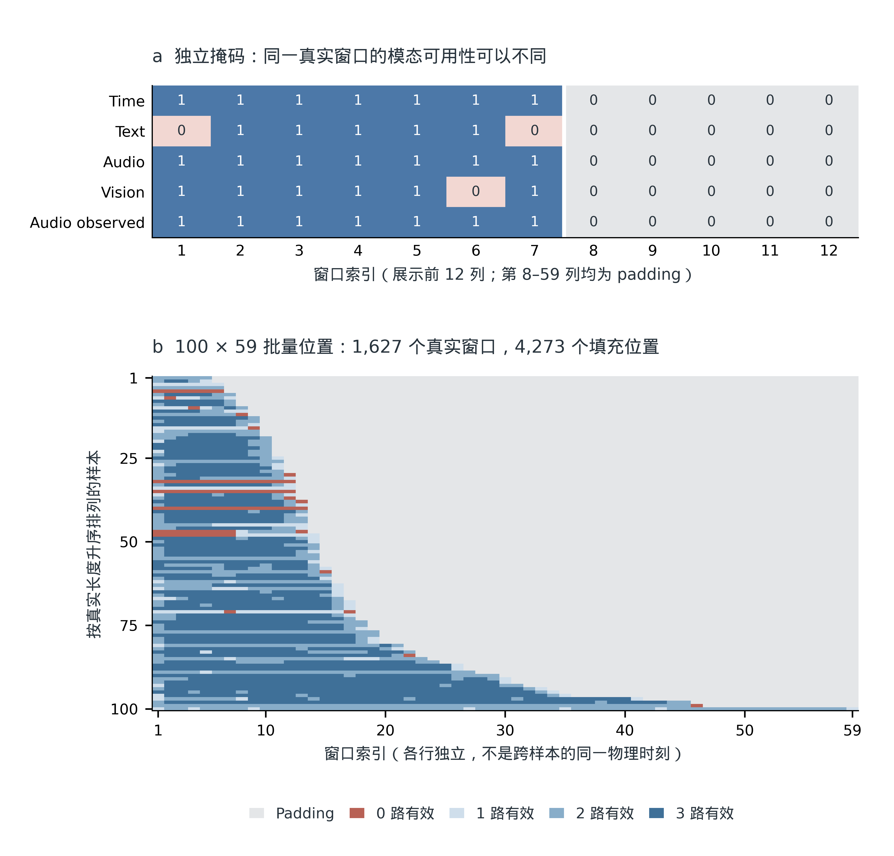
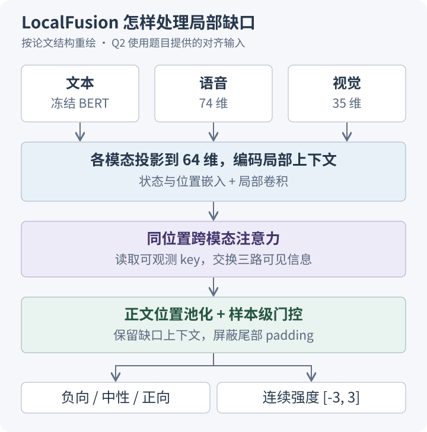
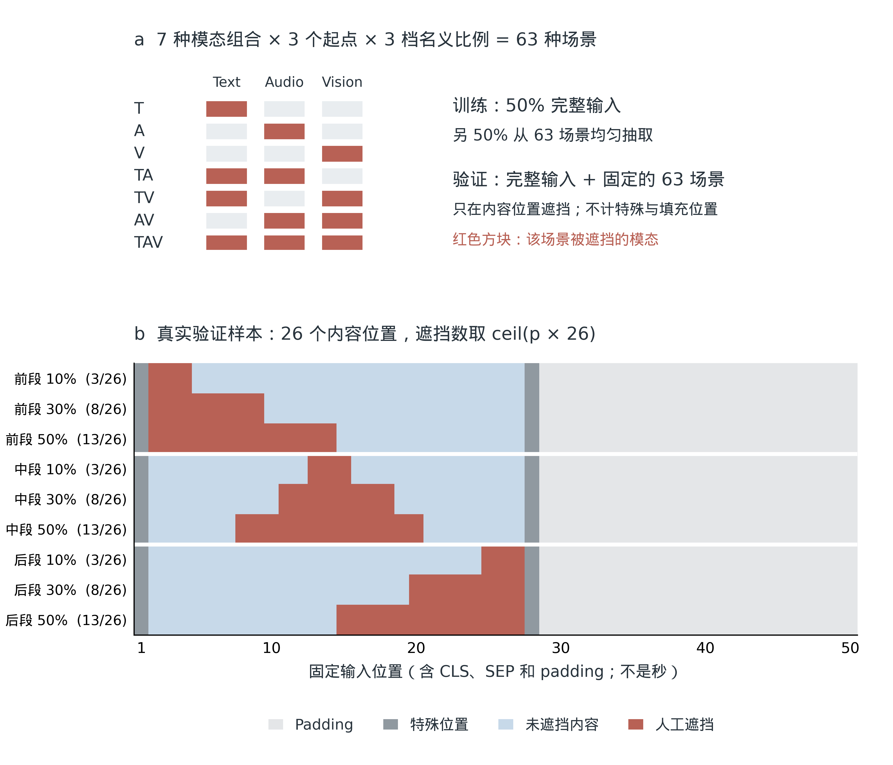
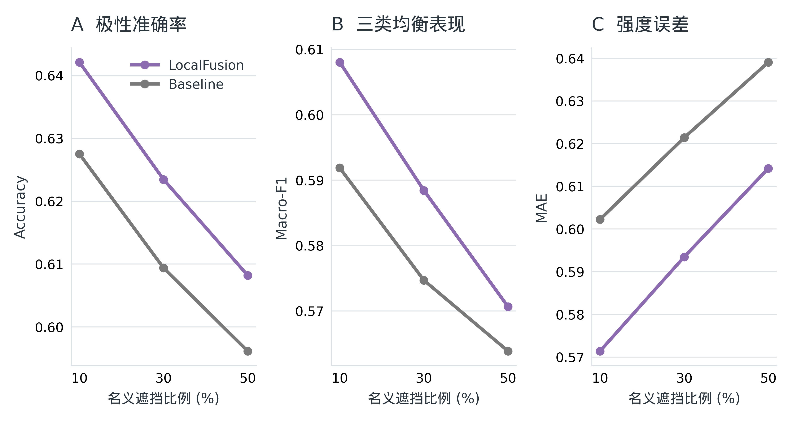
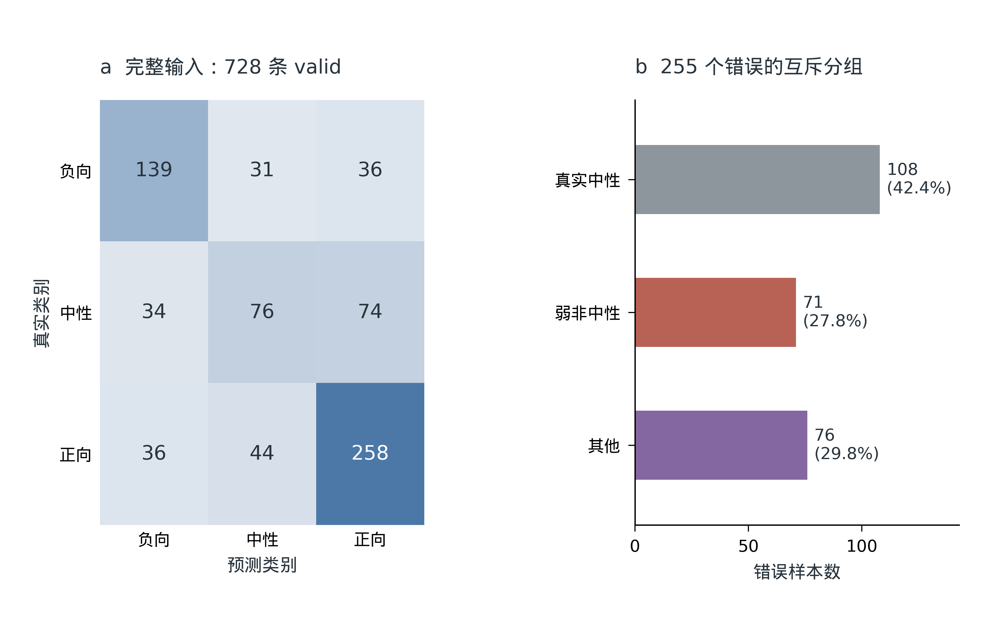
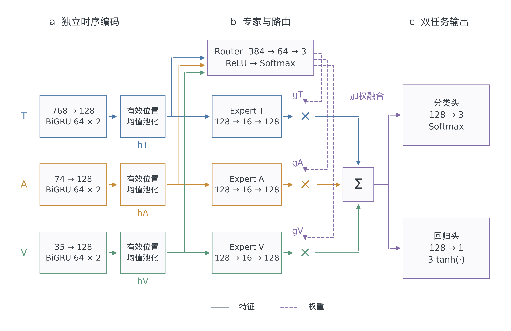
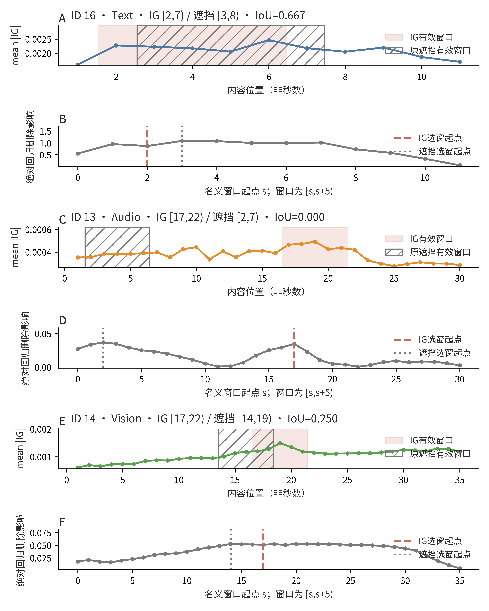

2026 年数模做的是多模态情感预测，最后获得了**三等奖**。输入同时包含文本、语音和视频，输出包括负向、中性、正向三类情感，以及连续情感强度。比赛中的三问分别要求构建时序特征、处理局部模态缺失，并解释模型主要参考了什么内容。

我把工作分成了三个工程入口：Q1 处理原始媒体与时间对齐，Q2 用 LocalFusion 做缺失条件下的预测，Q3 用模态专家模型 M3 做预测和证据分析。每问都保留了代码、运行产物和论文对应材料，归档在 [study_shumo_2026](https://github.com/yangzhe0/study_shumo_2026)。仓库为私有，需要相应 GitHub 权限。

## 问题一：特征提取与时间对齐

### 对齐先从时间含义开始

一条视频的文本按词组织，音频特征按短时分析窗组织，人脸特征按视频帧组织。它们的序列长度不同，而且“数组中的第十行”在三种模态里指向不同的时间。

Q1 先提取各模态的原生序列，再放到视频的呈现时间轴上。文本使用冻结的 `bert-base-uncased`，将 WordPiece 表示归并回原文词位，得到 768 维向量；语音使用 openSMILE 的 eGeMAPSv02 低层描述符，得到 25 维序列；视觉用 FaceMesh 提取 468 个三维关键点，中心化并按尺度归一化后得到 1,404 维表示。

之后以 **0.5 秒为窗口聚合**。文本按词时间区间与窗口的交叠长度加权，声音和人脸几何特征对窗口内的有效观测求均值。输出除特征外，还保存有效长度、模态掩码和来源索引。

*论文中的 Q1 总体流程：三路原生特征先关联呈现时间，再生成窗口特征、掩码与来源索引。*

### 质量门控与缺失掩码

文本时间关联单独做了一层检查：用独立 ASR 与原文进行有序词匹配，通过质量门控的词才借用识别时间。无法可靠关联的词保留语义表示，同时记录时间缺失。这样，原文内容与时间估计可以分别检查。

掩码需要区分几种情况：视频中确实存在这个时间窗，但某一路没有有效观测；为了批处理而补出的尾部位置；以及观测存在、数值恰好为零。实现中分别记录这些信息，后续聚合和可视化才有明确的统计范围。Q1 完成了附件 1 的 100 条样本处理。

*上图分开记录时间有效性、模态可用性和 padding；下图展示 100 条样本的窗口与填充分布。*

Q1 的表示用于本问的特征构建与核查。Q2、Q3 直接使用题目附件 2 的对齐输入，其中声学和视觉维度分别为 74 和 35；三问的工作入口在这里分开。

## 问题二：局部缺失下的情感预测

### LocalFusion 怎样利用缺口周围的信息

Q2 的缺失发生在序列内部：某一路或几路模态的连续位置被遮挡，其他位置仍然可见。模型需要知道缺口的位置，并利用本模态邻近内容和同位置的其他模态。

LocalFusion 先将三路输入投影到 64 维，加入状态和位置表示，用局部卷积编码邻域；随后在对齐位置做**跨模态注意力交互**，读取可观测的 key。各路再按正文位置做 *attention pooling*（注意力池化），结合覆盖率和来源不明比例，由样本级门控形成融合表示。

流程图按参赛论文结构重绘。池化阶段保留了由上下文形成的缺口表示，尾部 padding 则被排除。两个输出头分别预测三类极性和连续强度，强度通过 $3\tanh(\cdot)$ 限定在 $[-3,3]$。

训练同时使用分类与回归目标。除冻结 BERT 外，LocalFusion 有 86,572 个可训练参数，在有限比赛时间内可以完成多种条件下的比较。

### 把缺失设计成可重复的实验条件

我用七种模态组合 `T`、`A`、`V`、`TA`、`TV`、`AV`、`TAV`，配合前、中、后三种位置和 10%、30%、50% 三档名义比例，组成 **63 个连续遮挡场景**。`T`、`A`、`V` 分别表示文本、语音和视觉。训练时一半概率使用完整输入，另一半从这 63 个场景中抽取。

遮挡长度按正文位置计算，特殊词元和尾部填充另行处理。同一多模态场景使用同一段位置，因此 `TAV` 对应三路在同一段一起缺失。验证掩码在模型比较前固定，各变体看到同样的样本和缺口。

离散位置会让名义比例与实际比例有差别。例如，短样本的遮挡长度需要向上取整，验证集 10% 条件的平均实际遮挡比例是 12.97%。保存实际掩码和有效长度，可以把这一差异带进结果解释。

*上图列出 63 场景的组合方式，下图用一条真实样本展示前、中、后段遮挡及长度取整。*

正式方案训练了种子 2026、2027、2028 的三个模型，各运行 25 轮，按完整输入与固定缺失场景的联合验证损失选轮。推理时平均三个模型的 softmax 概率和回归值，分类取平均概率的最大项。

### 预测结果与设计取舍

在 728 条验证样本上，冻结集成模型的结果如下：

| 输入条件 | Accuracy | macro-F1 | 强度 MAE |
| --- | --- | --- | --- |
| 完整输入 | 64.97% | 0.6182 | 0.5637 |
| 63 种连续遮挡的平均值 | 62.46% | 0.5890 | 0.5930 |

图来自论文中的缺失比例实验，横轴为名义遮挡比例。已测条件中，遮挡比例从 10% 增至 50% 时，LocalFusion 的 Accuracy 从 64.21% 降至 60.82%，MAE 从 0.5714 增至 0.6142。含文本缺口的场景通常更难，声音或视觉单独缺失的变化相对较小。

与整段池化基线相比，LocalFusion 的缺失场景平均 MAE 更低。按验证样本配对重抽样时，种子级平均 MAE 差的 95% 区间为 `[-0.0392, -0.0133]`；Accuracy 差为 +0.779 个百分点，区间为 `[-0.260, 1.839]`。这组实验对强度误差改善提供了更明确的支持。

结构消融也留下了有用的取舍信息。去掉同位置交互后，缺失 Accuracy 为 62.18%，MAE 为 0.5916；完整模型分别为 62.46% 和 0.5930。分类点估计略高，回归误差略高，因此后续若要优化结构，应继续检查两个任务各自从交互层获得了什么。

误差分析中，中性类召回为 41.30%，强度预测在正负两端都出现向零收缩。附件 3 的 30 条样本全部完成预测，因附件没有标签，交付文件保留类别概率和连续强度，性能评价使用有标签的验证数据。

*左图查看三类情感之间的混淆，右图继续拆分 255 条错误，定位中性与弱情感样本的误差。*

右图中的“弱非中性”指真实标签为非中性、且真实强度绝对值不超过 0.5 的样本，用于细分错误类型。

## 问题三：预测依据与媒体回溯

### 用 M3 保留三条可干预的模态通路

Q3 需要解释模型主要参考哪一路输入，以及这一模态中的哪些局部位置。为此，我比较了直接拼接、门控融合、模态专家与跨模态注意力等结构，最后选择**保留独立模态通路的 M3**。

M3 将三路输入投影到 128 维，各自用 BiGRU 编码，并经过残差 Expert，再由 Router 融合到样本表示。分类和回归继续使用两个输出头。最终模型在验证集上的 Accuracy 为 63.46%、macro-F1 为 0.6161，强度 MAE 为 0.6025、Pearson 为 0.6363。

*M3 保留独立的文本、语音和视觉通路，经过专家与路由器后输出分类概率和连续强度。*

解释从冻结模型上的输入干预开始。先分别把文本、语音或视觉的有效输入置零，重新运行完整模型，记录分类概率和强度的变化；按**强度变化**确定主要参考模态后，再在该模态内，用长度 5、步长 1 的滑窗寻找影响较大的局部区域。

这种做法给出了可重复的检查路径。一次解释包含完整输入、干预位置、干预后输出和两者差值，能够对应到具体运行产物。Router 权重继续作为模型内部融合系数保存，模态作用则由输入干预计算。

### 解释怎样回到原始媒体

三个模态共有八种子集组合，Q3 对这些组合计算精确 Shapley，交叉检查模态层面的判断；局部位置再用 Integrated Gradients，与滑窗遮挡比较。同时保留同长度随机窗口和条件充分性分析，检查选中区域与其他区域的差异。

验证集上，Shapley 与模态删除有 707/728 条主导模态一致，比例为 97.12%；IG 与遮挡的局部窗口平均 IoU 为 0.2189，中位数为 0。两个层次给出了不同的信息：**模态选择较一致，局部位置对方法更敏感**。

附件 4 共 20 条样本完成预测，其中 17 条由文本主导，文本位置已关联回原文。对于需要检查声画的样本，还保留了目标短语回放和按实际呈现时间戳提取的视频帧。这样可以继续核对“特征中的这个位置”对应原始媒体的哪段内容。

*ID16 文本、ID13 音频、ID14 视觉的局部归因对照；横轴为特征位置，阴影标出所选窗口。*

媒体回看使用自动重建的时间区间，输入干预使用零值替代基线。这两个定义决定了解释的范围：结果描述冻结模型对给定输入变化的响应，时间区间帮助定位原始内容。后续可以在这套记录上增加人工时间标注和更多基线比较。

## 从这次比赛留下的工程组织方式

这次三等奖项目将表示构建、模型比较和结果解释拆成了独立入口。Q1 能沿来源索引检查一个窗口，Q2 能按固定掩码复查一次预测，Q3 能沿干预记录回到原文或媒体片段。论文中的每类结果也各有对应的代码和产物目录。

后续继续做多模态项目时，我会保留这种组织方式，并优先完善中性类评价、多段缺口测试和局部证据核验。它们分别对应这次实验里已经观察到的误差类型。

## 代码与材料

- [私有仓库：study_shumo_2026](https://github.com/yangzhe0/study_shumo_2026)
- [Q1：特征提取、时间对齐与验证产物](https://github.com/yangzhe0/study_shumo_2026/tree/main/Q1)
- [Q2：LocalFusion 与缺失实验](https://github.com/yangzhe0/study_shumo_2026/tree/main/Q2)
- [Q3：M3、输入干预与媒体回溯](https://github.com/yangzhe0/study_shumo_2026/tree/main/Q3)
- [论文主入口与各节源文件](https://github.com/yangzhe0/study_shumo_2026/tree/main/latex)
