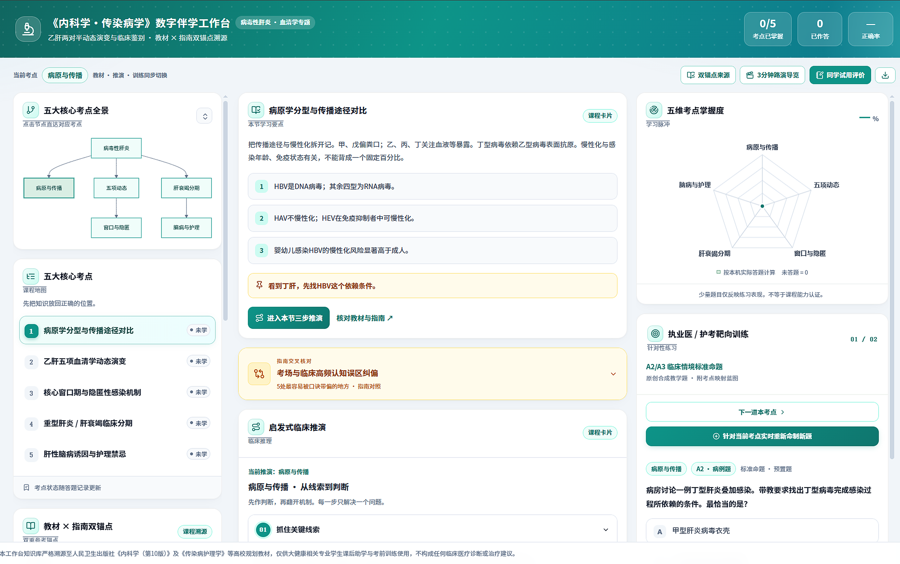
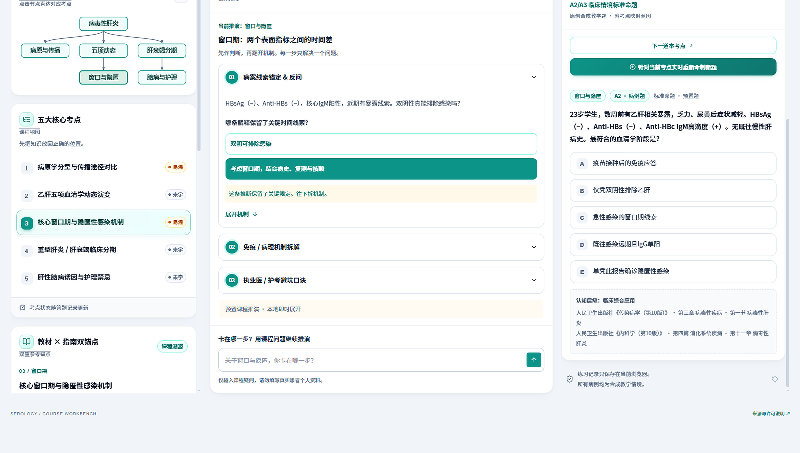

旋创赛第三轮展示的项目，是《内科学·传染病学》数字伴学工作台 Study3。我围绕病毒性肝炎课程做了一套网页：左侧选考点和查看来源，中间读课程、操作沙盘与分步推演，右侧做情境题、看错因，再回到对应知识点。

项目的体验入口是 [study3.zheoi.com](https://study3.zheoi.com/)，源码和参赛产物保存在 [xuanchuang-2026](https://github.com/yangzhe0/xuanchuang-2026)。第三轮材料放在 `第三轮/`，持续维护的工作台源码位于 `第二轮/最终版/`，两个目录共同记录了这次最终展示的产品。



## 从一个考点完成一次学习过程

我把工作台做成了**三栏联动**。左栏的五个考点负责导航，并提供教材与指南的来源；中栏展开对应课程和推演；右栏放同考点练习、逐选项错因和变式。切换考点时，相关内容一起切换。

以“窗口与隐匿”考点为例，用户先读课程卡片，再进入预置的三步推演。第一步给出病案线索和二选一问题，第二步展开机制与时间轴，第三步归纳判断要点。右侧情境题接着检验用户是否理解刚才的限定条件。

如果答错，页面根据所选选项显示对应错因。用户可以回到教材切片查看相关知识，同时**保留正在作答的题目和状态**；随后打开同考点的独立变式，再做一次判断。



两张截图来自第三轮参赛材料归档。病例与题目使用合成教学情境，工作台面向课程学习和练习。

## 知识库与本地沙盘

### 让内容和交互共享同一套标识

知识库使用结构化 JSON，分别组织课程主题、来源、沙盘组合、预置推演、标准题和变式。主题 ID 连接课程和练习，来源 ID 连接内容与出处，变式通过 `parentQuizId` 关联原题。

这套连接让交互有了具体目标。例如，错因中的 `anchorTopicId` 指向相应课程切片，页面可以定位并提示用户查看；变式知道自己对应哪道原题，前端可以保留学习关系，又开始一次新的作答。

教材与指南分别记录来源，页面按当前考点展示。扩展课程时，可以继续增加主题、来源和题目，再接入现有界面。实际维护仍需要检查各项内容之间的映射，以及每道题的答案、逐选项错因和来源是否一致。

### 动态沙盘用确定性规则即时响应

沙盘允许用户切换五项血清学指标，并补充核心抗体分型和核酸状态。实现将五个布尔量、两种分型和三种核酸状态组织为 $2^5\times2\times3=192$ 种输入状态，再由本地规则匹配典型组合或进入非典型提示。

`public/serology.js` 中的 `interpret(kb, state)` 返回判读结果、考点和来源 ID，前端据此更新内容。用户拨动开关时即可看到变化，**交互无需等待模型接口**。

这项设计把高频操作保持在本地。预置组合和教学规则容易检查，也能枚举输入核验覆盖情况；需要进一步追问、针对当前内容生成讲解时，再使用在线模型。

沙盘和推演共用状态，但各自承担不同工作。沙盘负责根据输入更新结果，三步推演负责把线索、机制和判断过程逐步展开。前端在两者之间同步当前考点，让用户继续练习相关问题。

## 预置内容与在线生成

### 预置题库与实时任务

最终版保留 12 组典型组合、6 组预置推演、10 道原创情境题和 10 道独立变式。常用课程和预置流程可以直接展开；在线功能包括补充推演、命制新题和针对错选项生成解释。

前端可以区分内容来自**预置、实时生成还是本地兜底**。比如自定义问题遇到模型失败时，返回的提示会说明当前显示的是相关课程卡片，用户因此知道自己的提问是否已被处理。

在线模型返回结构化 JSON，再由服务端检查步骤、选项、答案索引、错因和考点等字段。**只有格式和内容规则通过后，结果才进入固定组件**。这样，模型生成的文字能够接进现有操作流程，题目和推演的界面结构也保持稳定。

### 主备网关与输出校验

后端按顺序请求主网关和备用网关。一次尝试包括连接、HTTP 状态、JSON 解析、内容规则和 schema 校验，任一环节失败都可以继续尝试下一通道；**全部失败后，任务层返回本地内容**。

归档代码的默认单通道超时为 40 秒。前端请求设置了更长的等待上限，为主备尝试留出时间，同时保留课程和预置交互。服务端分别记录最后成功通道和失败阶段，便于区分上游故障与输出结构问题。

模型密钥留在服务端环境变量中。公开接口还设置了请求频率和并发限制，避免展示入口的连续请求占满在线服务。相关阈值属于当前部署参数，后续可以结合实际访问情况调整。

```text
用户请求在线任务
  → 主网关：请求、解析、校验
  → 失败后尝试备用网关
  → 全部失败则返回本地课程内容
  → 前端显示内容来源和处理状态
```

## 页面切换后，旧响应应该怎样处理

用户在考点 A 请求在线推演，等待期间切换到考点 B。A 的结果稍后返回，如果直接写入页面，就会出现“左边选 B，中间显示 A”的错位。网络超时设置解决不了这个状态问题。

前端用 `contextRevision`、`quizRevision`、`pblVersion` 和 `diagnosisJob` 分别管理课程、题目、推演和错因任务。发起请求时保存当前版本，返回后比较：**上下文已经变化，就保留当前页面**，并提示旧任务未覆盖新内容。

教材回溯又有另一项要求。用户查看错因对应的课程内容时，当前答案和题目仍要保留，因此代码将课程导航与练习状态分开管理。这样，回看知识不会顺手清空正在复盘的题目。

## 用模拟网关检查故障分支

仓库的集成脚本启动本地模拟网关，让主通道返回错误，再检查备用通道能否接管。脚本还构造坏 schema、内容规则失败和双通道失败，检查本地回退，并确认预置任务不会调用模型。

其他检查覆盖请求方法、载荷格式、体积限制、频率限制、凭据文件不可公开读取，以及反馈写入与导出权限。测试反馈使用独立临时文件，避免写入正式试用数据。

这类检查直接对应路演和实际使用中可能遇到的情况。页面能正常展示之外，还需要确认断网、上游出错、输出结构不合格或用户提前切换时，已有课程与练习保持可操作。

参赛材料另记录了五份校内试用反馈，主要涉及首次引导、缩写解释、病例扩充、复习安排和移动端提示。这批反馈用于改进交互；学习效果可以在后续目标专业试用中继续评价。

## 继续维护时从哪里开始

我会先保留现有知识库与页面之间的映射，再逐条处理试用提出的问题。新增一个课程模块时，需要一起准备课程切片、来源、推演、标准题和独立变式，检查学习过程是否能从头走通。

最终版保留了 OpenAPI 和技能说明，便于后续封装与复用。第三轮的展板和商业计划书则记录了当时的产品定位与后续设想。复看实现应从维护源码和测试入口开始，展示材料可以辅助理解产品场景。

## 体验、源码与材料

- [工作台体验入口](https://study3.zheoi.com/)
- [私有总仓库：xuanchuang-2026](https://github.com/yangzhe0/xuanchuang-2026)，需要相应 GitHub 权限
- [最终版源码与运行说明](https://github.com/yangzhe0/xuanchuang-2026/tree/main/%E7%AC%AC%E4%BA%8C%E8%BD%AE/%E6%9C%80%E7%BB%88%E7%89%88)
- [第三轮展示与参赛材料](https://github.com/yangzhe0/xuanchuang-2026/tree/main/%E7%AC%AC%E4%B8%89%E8%BD%AE)
- [结构化知识库](https://github.com/yangzhe0/xuanchuang-2026/blob/main/%E7%AC%AC%E4%BA%8C%E8%BD%AE/%E6%9C%80%E7%BB%88%E7%89%88/data/knowledge_base.json)
- [后端网关实现](https://github.com/yangzhe0/xuanchuang-2026/blob/main/%E7%AC%AC%E4%BA%8C%E8%BD%AE/%E6%9C%80%E7%BB%88%E7%89%88/server.mjs) 与 [集成检查](https://github.com/yangzhe0/xuanchuang-2026/blob/main/%E7%AC%AC%E4%BA%8C%E8%BD%AE/%E6%9C%80%E7%BB%88%E7%89%88/scripts/integration.mjs)
