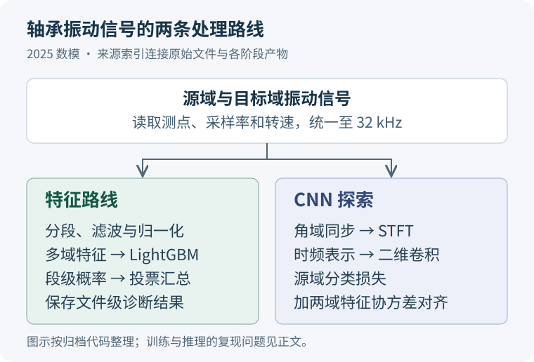
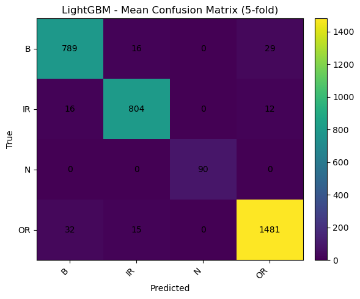

2025 年参加“华为杯”第二十二届中国研究生数学建模竞赛时，我做的是高速列车轴承智能故障诊断。题目给出两类数据：带标签的试验台架振动信号，以及没有故障标签的列车运行信号。工作从整理原始文件开始，最后要给出目标域文件的故障类别，并解释判断依据。

我把它做成了两条可以对照的处理路线：一条提取时域、频域、包络谱和小波包特征，用 LightGBM 分类；另一条把信号变成时频表示，交给 CNN 学习。比赛产物包括处理后的数据、模型、预测文件和论文图表。

项目代码与最终论文放在 [study_shumo 仓库](https://github.com/yangzhe0/study_shumo)。

## 先把振动文件变成可追查的样本

数据来自不同采样率、测点、转速和故障状态。直接把文件堆成一个训练集，会丢掉这些条件，也很难在某个结果异常时找到对应的原始波形。

预处理首先建立索引，保留文件路径、采样率、类别、负载、转速、故障尺寸和安装位置等信息。源域的四个分类标签是滚动体故障 B、内圈故障 IR、外圈故障 OR 和正常状态 N。后续生成的波形段和特征表都带着来源信息，模型输出可以沿索引往回查。

特征路线把采样率统一到 32 kHz，再从驱动端数据生成固定长度波形段。归档分段脚本使用 4,096 点窗口、2,048 点步长，对应每段 0.128 秒、相邻段重叠一半。固定窗口让不同文件可以进入同一个特征提取接口，重叠则增加了短时冲击被窗口完整覆盖的机会。

每段依次经过 100～5,000 Hz 带通滤波、`db4` 小波去噪和幅值归一化，再保存为 `.npy`。索引表另存起止采样点和段编号，特征计算不必反复读取整条长信号。

逐段幅值归一化突出波形形态，也改变了绝对幅值的含义。归一化后计算的 RMS 应放在这条处理流程中理解；如果后续任务需要比较真实振动幅值，就应另外保留物理量分支。

## 用四组特征描述冲击和频率结构

一段波形经过特征提取后变成一行表格。这样既便于训练树模型，也方便逐项检查哪些量在区分类别。

| 特征组 | 归档实现中的代表量 | 关注的信息 |
| --- | --- | --- |
| 时域 | RMS、标准差、偏度、峭度、峰峰值、波形因子 | 波形能量、形状与短时冲击 |
| 频域 | 主峰、谱重心、频率离散度、谱熵、滚降频率 | 能量集中在哪些频率、分布是否分散 |
| 包络谱 | 故障特征频率附近的能量 | 周期性冲击的调制结构 |
| 小波包 | 各频带相对能量与能量熵 | 不同尺度和频带上的能量分配 |

例如，RMS 和峭度分别描述幅值规模与分布形状：

$$
\begin{aligned}
x_{\mathrm{RMS}}&=\sqrt{\frac{1}{N}\sum_{i=1}^{N}x_i^2},\\
K&=\frac{\mathbb{E}[(x-\mu)^4]}{\sigma^4}-3.
\end{aligned}
$$

单看这两个量还不足以区分故障位置，所以我同时加入频谱和包络谱信息。实现中先用 Hilbert 变换取包络，再计算包络功率谱，累计轴承特征频率附近的能量。小波包则将信号分成多个频带，用相对能量降低整体幅值对表示的影响。

转速会影响故障频率的位置。训练 Notebook 还加入了部分按转频归一化的派生特征，将频率转换为阶次，按“一转发生多少次”描述频率。转速字段是否正确，也因此成为整条特征链路的关键前提。

## LightGBM 路线：先建立能比较的基线

结构化特征适合从树模型入手：训练成本较低，混淆矩阵可以直接暴露类别间的混淆，特征重要性也方便回查输入。归档 Notebook 对比了 LightGBM、随机森林，以及 PCA 后的逻辑回归。

样本数并不均衡。该 Notebook 记录的波形段中，OR 有 7,640 段，B 有 4,171 段，IR 有 4,162 段，N 有 450 段。训练为不同类别设置样本权重，评价同时记录 Accuracy 和 macro-F1，让正常类的表现也进入模型比较。

下面是 `3.1源域故障诊断_LightGBM.ipynb` 保存的五折运行输出：

| 模型 | 平均 Accuracy | 平均 macro-F1 |
| --- | --- | --- |
| LightGBM | 0.9632 | 0.9698 |
| RandomForest | 0.9456 | 0.9544 |
| LogReg + PCA20 | 0.6460 | 0.7118 |

这是源域归档运行的结果。Notebook 使用 `StratifiedGroupKFold`，希望按原始文件分组，但分组函数中去除 `_seg` 后缀的正则存在转义问题，文末给出具体位置；复现时应先修正分组，再重算这些指标。

## 从波形段预测回到整条文件

目标域仍然经过分段和特征提取，按训练时保存的特征列顺序组装输入。模型对每个段输出四类概率，再汇总成文件级结果。归档中保留了两种汇总：硬投票统计各段预测类别，软投票平均各段的类别概率。

设文件有 $M$ 个段，第 $j$ 段对类别 $c$ 的概率为 $p_j(c)$，软投票为：

$$
\begin{aligned}
\bar p(c)&=\frac{1}{M}\sum_{j=1}^{M}p_j(c),\\
\hat y&=\arg\max_c\bar p(c).
\end{aligned}
$$

文件级输出比一长串段标签更便于交付，保留段级结果则有助于检查文件内部是否出现判断不一致。比如，某条信号前半段主要预测为 B，后半段主要预测为 IR，就值得继续看对应波形和工况，而不只取一个最终标签。

归档的 `target_file_preds.csv` 包含 A～P 共 16 个文件的结果。复看时可以先打开这张表，再沿 `target_segment_preds.csv` 找到具体波形段，最后回到原信号。目标域没有提供真实标签，这部分产物展示的是预测与追查流程。

## CNN 路线：保留时频位置关系

手工特征把每个窗口压缩成少量统计量。CNN 路线则保留更多局部结构：信号先重采样，再按转速做角域同步，之后用 STFT 生成对数幅值图。

角域同步把采样轴从时间转换到旋转角度。归档实现按每转 720 点插值，再计算 STFT，使输入中的频率轴可以按阶次理解。二维 CNN 通过卷积、BatchNorm、ReLU 和池化提取表示，最后由全连接层完成分类。

迁移训练代码同时取一批源域和目标域数据。源域标签提供分类损失，两个域的特征协方差差异提供对齐损失：

$$
\begin{aligned}
D&=C_s-C_t,\\
\mathcal L&=\mathcal L_{\mathrm{cls}}+
\lambda\operatorname{mean}(D\odot D).
\end{aligned}
$$

这条路线把“减少两个域的表示差异”放进了训练目标。它也增加了需要核验的环节，包括角域重采样所用转速、输入图的尺寸，以及数据集类与训练脚本之间的接口。仓库保存了这部分探索代码，后续复现可以与特征路线分别运行、比较。

## 现在回看，应该优先修正什么

重新对照论文与归档代码，可以看到几处会影响结果解释的实现问题，分别涉及数据字段、划分方式和推理接口。

首先是文件分组。当前 Notebook 使用 `r"_seg\\d+$"` 去掉分段后缀；对 `sample_seg17` 这样的名称，预期规则应写成 `r"_seg\d+$"`。复现时要检查同一原始文件的所有段是否只出现在一个折内，尤其是这里的窗口存在重叠。

其次是训练和推理的变换。该 Notebook 用原始 `X` 拟合最终树模型，又单独保存了 `StandardScaler`；目标域脚本先调用 scaler，再把结果送进模型。重新整理工程时，应把特征顺序、变换和模型封装成统一接口，保证训练与推理使用同一种输入表示。

另外，源域分段脚本把输出 `rpm` 写成了固定的 `600`，包络频率和阶次特征却依赖转速；目标域树模型脚本的 CORAL 调用则把同一个 `X_std` 同时作为两个域传入。这两处都需要沿原始索引重新核对，并用修正后的数据重跑。

如果继续维护这个项目，我会先完成上述链路修正，再比较按文件分组的源域表现、跨工况表现和目标域预测稳定性。原始文件索引、分段产物和归档 Notebook 为这次重算保留了入口。

## 代码与材料

- [完整仓库与最终论文](https://github.com/yangzhe0/study_shumo)
- [第一问：预处理、重采样、分段和特征提取](https://github.com/yangzhe0/study_shumo/tree/master/%E7%AC%AC1%E9%97%AE)
- [第二问：模型对比与源域诊断 Notebook](https://github.com/yangzhe0/study_shumo/tree/master/%E7%AC%AC2%E9%97%AE)
- [第三问：目标域特征、预测与文件级汇总](https://github.com/yangzhe0/study_shumo/tree/master/%E7%AC%AC3%E9%97%AE)
- [CNN 路线：角域表示与迁移训练代码](https://github.com/yangzhe0/study_shumo/tree/master/%E7%AC%AC3%E9%97%AE_CNN)
